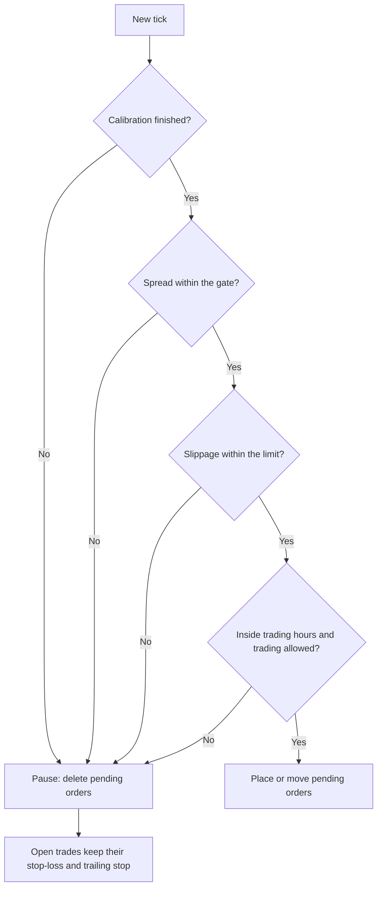

# XAUUSDBOTS Adaptive Spread LIVE V2

**Version 2.20 | MetaTrader 5 Expert Advisor | Built for gold (XAUUSD)**

A self-calibrating EA that measures your broker's spread, commission, slippage, latency and tick rate, then sets its own distances and filters to match. This guide explains how it works and what every setting does.

Download and support: <https://patreon.com/xauusdbots>

> **Risk warning.** Trading leveraged products such as gold carries a high risk of loss. This EA does not guarantee profit. Demo results, backtests and past results do not predict live results. This guide is educational and is not financial advice. Only trade money you can afford to lose.

---

## Table of contents

1. [What this EA does](#what-this-ea-does)
2. [What is new in v2](#what-is-new-in-v2)
3. [Requirements](#requirements)
4. [Installation](#installation)
5. [Quick start](#quick-start)
6. [How auto-calibration works](#how-auto-calibration-works)
7. [Settings reference](#settings-reference)
8. [Worked example](#worked-example)
9. [Reading the chart panel and the Experts log](#reading-the-chart-panel-and-the-experts-log)
10. [Suggested starting profiles](#suggested-starting-profiles)
11. [Troubleshooting](#troubleshooting)
12. [FAQ](#faq)
13. [Glossary](#glossary)
14. [Risk and best practices](#risk-and-best-practices)
15. [Support](#support)

---

## What this EA does

XAUUSDBOTS Adaptive Spread LIVE V2 places pending **buy-stop** and **sell-stop** orders around the current price. When price breaks through one of them, the order fills with a stop-loss already attached, and a trailing stop then follows the trade.

Every distance the EA uses is a multiple of one number, the **cost unit**:

```
cost unit = average spread + commission (as a price distance) + average slippage
```

When your broker's costs change, every distance changes with them. In v2 the EA measures those costs itself, so you no longer have to hand-tune it for each broker.

### How a trade works

1. The EA keeps one buy stop above the price and one sell stop below it, each about 3.5 cost units away by default.
2. As price moves, the EA repositions the pending orders to keep that distance. It only does so when the price has moved enough to matter, so it does not flood the broker with requests.
3. When price breaks through a pending order, the order fills with a stop-loss already attached (8 cost units by default). The EA sets **no take-profit**.
4. Once the trade is in profit, a trailing stop follows price at a distance that grows with the profit.
5. If conditions turn bad (spread too wide, slippage too high, outside trading hours), the EA deletes its pending orders. Open trades keep their stop-loss and trailing stop.

### When the EA pauses



---

## What is new in v2

| Area | Earlier version (v1.40) | v2 |
| --- | --- | --- |
| Spread limit | Fixed `MaxSpread` in points | Measured normal spread times a multiplier |
| Commission | Ignored | Learned from your closed deals, or entered by hand |
| Slippage | Not measured | Measured on every entry and added to the cost unit |
| Order modifications | Every tick | Paced by measured broker latency |
| Tick rate | Fixed `TickModulus` | Chosen from measured ticks per second |
| Stop and freeze levels | Read once at start | Re-read every tick; distances scale up if needed |
| Lot size | Margin-based formula | Risk % over the stop distance (default) |
| Safety | Basic | Margin check, position cap per side, Friday cut-off, trading-permission check, error logging |

---

## Requirements

- MetaTrader 5 (any broker that offers a gold symbol and allows expert advisors and pending orders)
- A gold symbol such as `XAUUSD` or `XAUUSD.s` (use the exact name your broker gives)
- A stable connection. A VPS close to your broker's server is recommended
- No DLLs, no web requests and no extra files are needed

---

## Installation

1. In MT5, open **File > Open Data Folder**.
2. Copy `XAUUSDBOTS_ADAPTIVE_SPREAD_LIVE_V2.mq5` into `MQL5\Experts`.
3. Open **MetaEditor** (press F4), open the file and press **F7** to compile. It should finish with no errors. (Restarting MT5 also compiles it.)
4. In MT5, the EA now appears in the **Navigator** under **Expert Advisors**.

---

## Quick start

1. Open a chart of your broker's gold symbol. The EA reacts to ticks, so the timeframe does not matter.
2. Drag the EA onto the chart.
3. On the **Common** tab, tick **Allow Algo Trading**, then press OK.
4. Make sure the **Algo Trading** button in the MT5 toolbar is green.
5. Keep the default settings for your first session. If your account is Raw or ECN with a commission, enter it in `CommissionPerLot`.
6. Watch the panel in the top-left of the chart. It shows **CALIBRATING** for the first 60 seconds, then **ACTIVE**.
7. After about 5 minutes, open the **Experts** tab in the Toolbox and look for a line starting with `BROKER PROFILE`.

### First-day checklist

- Start with the smallest lot size your broker allows, or set `FixedLot`.
- Run one copy of the EA per symbol per account. A second copy needs a different `MagicNumber`.
- Keep the terminal running without interruption.
- Do not change `MagicNumber` while trades are open, or the EA will stop managing them.

---

## How auto-calibration works

v2 builds a profile of your broker from live measurements instead of relying on fixed numbers. It measures six things.

| Measurement | How it is taken | What it controls |
| --- | --- | --- |
| Normal spread | One spread sample per second; the median of the last `BaselineSeconds` (30 minutes by default) | The spread gate that pauses trading |
| Commission | Round-turn commission per lot, from closed deals on this symbol (up to the 30 most recent closed positions in the last 60 days at start-up, then every closed trade) | The commission part of the cost unit and the break-even point for trailing |
| Slippage | Fill price versus pending-order price on every entry; only worse-than-requested fills count, smoothed over time | The cost unit and the slippage pause |
| Latency | How long the broker takes to answer successful order and modify requests | The minimum gap between order modifications |
| Tick rate | Ticks per second, measured over 5-second windows | How often the order logic runs (`TickModulus`) |
| Stop and freeze levels | Read from the broker on every tick | Minimum distances; all distances scale up if needed |

### The cost unit

The average spread is weighted toward the most recent ticks, so it reacts quickly when spreads move. The cost unit never drops below half of the normal spread, so a briefly tiny spread cannot shrink every distance to nothing.

### When the EA pauses

The EA stops placing orders and deletes its pending orders when any of these is true:

- It is still calibrating after start-up.
- The current spread is above the spread gate (normal spread times `AutoMaxSpreadMult`).
- Average slippage is above the slippage limit (normal spread times `MaxSlipToSpread`).
- The time is outside your trading hours, or it is the Friday cut-off.
- Algo trading is disabled in the terminal, on the account, or for the symbol.

Open trades are never abandoned while paused: their stop-loss and trailing stop keep working. While paused for slippage, the stored slippage average falls by 10% every minute, so the EA eventually tests your broker again instead of staying off forever.

### Stop-level fit

Some brokers enforce a minimum stop distance that is larger than the EA's planned order distance. When that happens, v2 scales every distance (order, signal, maximum, stop, trailing) by the same factor, up to 5 times, so the proportions between them stay the same.

### What the EA cannot know in advance

- **Commission** is only visible once a trade has closed. On a new Raw or ECN account, enter `CommissionPerLot` yourself for the first trades. After that the EA uses the value it learned.
- **Slippage and latency** only show up in real fills and real requests. The first trades on a new account are therefore the least calibrated.
- **Saved values** (slippage, commission, latency) are stored per account and symbol, so a restart does not reset them. MT5 deletes saved terminal values that have gone unused for about four weeks. The 60-second spread calibration runs again after every restart.

---

## Settings reference

Defaults suit most accounts. Change the auto-calibration inputs only when the panel or the log shows a clear reason. All "points" below are the broker's points for your symbol; on a 2-digit gold symbol, 1 point is 0.01 of price.

### Identification

| Input | Default | What it does | When to change it |
| --- | --- | --- | --- |
| `TradeComment` | https://patreon.com/xauusdbots | Text attached to every order the EA places | Only if you want your own label |
| `MagicNumber` | 20180910 | The ID that marks this EA's orders and trades | When you run two copies on one account; never while trades are open |
| `Slippage` | 30 | Price deviation (points) sent with orders | Rarely. Pending orders trigger at market, so v2 measures real slippage separately |

### Auto-calibration

| Input | Default | What it does | When to change it |
| --- | --- | --- | --- |
| `AutoCalibrate` | true | Master switch for the measured spread gate, cost floor, slippage limit and stop-level fit | Turn off only to use the fixed manual values |
| `CalibrationSamples` | 60 | Seconds of spread samples collected before trading starts | Raise to 120-300 if your broker's spreads jump around |
| `BaselineSeconds` | 1800 | Length of the window used for the normal-spread median | Shorter (600) follows session changes faster; longer (3600) is steadier |
| `AutoMaxSpreadMult` | 2.5 | The EA pauses when spread exceeds normal spread times this | Lower (1.8-2.0) for stricter filtering and fewer trades; higher (3-4) to trade through wider spreads |
| `MaxSpreadCap` | 0 | Optional hard ceiling on spread, in points (0 = none) | When you want an absolute limit regardless of the measured baseline |
| `MaxSlipToSpread` | 2.0 | The EA pauses when average slippage exceeds normal spread times this (0 = off) | Lower (1.5) if you want it to pause sooner on poor fills |
| `AutoCommission` | true | Learns round-turn commission per lot from closed deals | Turn off only if you always want your manual figure |
| `CommissionPerLot` | 0.0 | Round-turn commission for 1 lot, in account currency; used until a value is learned, or always if `AutoCommission` is off | Raw and ECN accounts: enter your broker's figure. If the broker charges 3.50 per lot per side, enter 7.00 |
| `AutoTickRate` | true | Sets how often the order logic runs, from the measured tick rate | Turn off to use the manual `TickModulus` |
| `TargetEvalsPerSec` | 5.0 | How many times per second the order logic should run | Higher is more responsive but sends more requests; lower is calmer |
| `AutoCooldown` | true | Sets the minimum gap between modifications to 1.5 times measured latency (limited to 100-2000 ms) | Turn off to use the manual `ModifyCooldownMs` |
| `PersistLearning` | true | Saves learned slippage, commission and latency across restarts | Leave on |

**Two tips.** `AutoMaxSpreadMult` is the single most useful tuning knob: it decides how much spread widening the EA tolerates. If your spreads change a lot between sessions, a shorter `BaselineSeconds` helps the baseline keep up.

### Manual values

The manual values are a fallback. Each one only applies when the matching auto switch is off, so with the defaults you can ignore them.

| Input | Default | Used when | What it does |
| --- | --- | --- | --- |
| `MaxSpread` | 40 | `AutoCalibrate` is off | Fixed spread limit in points |
| `SpreadSpikeFactor` | 2.5 | `AutoCalibrate` is off | Also pauses when the current spread exceeds the recent tick average times this |
| `MinMeasure` | 5 | `AutoCalibrate` is off | Smallest allowed cost unit, in points |
| `MaxAvgSlipPoints` | 0 | `AutoCalibrate` is off | Fixed slippage limit in points (0 = off) |
| `TickModulus` | 2 | `AutoTickRate` is off | Runs the order-adjustment logic on every Nth tick |
| `ModifyCooldownMs` | 300 | `AutoCooldown` is off, and until latency has been measured | Minimum milliseconds between order or stop-loss modifications |

### Timing

| Input | Default | What it does | When to change it |
| --- | --- | --- | --- |
| `TickSample` | 30 | Number of recent ticks in the short-term spread average, weighted toward the newest | Higher is smoother but slower to react; lower reacts faster but is noisier |
| `TradeInterval` | 0 | Minimum seconds between placing new pending orders | Raise to slow the EA down |
| `Secs` | 60 | A pending order that has not moved for this many seconds is repositioned | Rarely |
| `UseTimeFilter` | true | Turns the trading-hours window on or off | Turn off to trade around the clock (the Friday cut-off still applies) |
| `StartHour` | 2 | First server hour the EA may trade | Match your broker's liquid hours |
| `EndHour` | 22 | Last server hour the EA may trade (it trades until 22:59) | Match your broker's liquid hours |
| `FridayStopHour` | 21 | From this server hour on Friday, no pending orders are kept; this applies even when `UseTimeFilter` is off | Move earlier to be flat before the weekend; open trades keep their stops |

**Server time.** `StartHour`, `EndHour` and `FridayStopHour` use the broker's server time, which is the clock shown in Market Watch, not your local time. Many brokers widen spreads around the daily rollover near server midnight. The default `EndHour` of 22 keeps the EA out of that window, but check your own broker's rollover time and adjust.

### Lot sizing and safety

| Input | Default | What it does | When to change it |
| --- | --- | --- | --- |
| `LotMode` | LOT_RISK_STOP | `LOT_RISK_STOP` sizes each order so that hitting the stop-loss loses about `RiskPercent` of balance. `LOT_MARGIN_LEGACY` uses the original margin-based formula | Use LEGACY only to reproduce old behaviour |
| `FixedLot` | 0.0 | A value above 0 overrides all automatic sizing | Recommended for your first sessions |
| `RiskPercent` | 1.0 | Percent of balance risked per order if the stop-loss is hit (`LOT_RISK_STOP`) | Lower for caution. Slippage and gaps can make a real loss larger than the calculation |
| `MaxLotCap` | 0.0 | Hard ceiling on lot size (0 = no cap; the broker's own maximum still applies) | Set a cap you are comfortable with |
| `Aggressive` | 3.0 | Lets the EA add to a trade once all open trades on that side have their stop-loss at or beyond entry; the new order is placed closer, at the normal distance divided by this value | 1.0 turns stacking off: one position per side |
| `MaxPositionsPerSide` | 3 | Maximum open trades in one direction | Lower to 1 for the smallest exposure |
| `MarginSafety` | 3.0 | An order is only placed if free margin is at least this multiple of the margin it needs | Raise for a bigger safety buffer |
| `MinStepFactor` | 0.25 | A pending order or stop-loss is only modified when the price change is at least this fraction of the cost unit | Raise to send fewer requests to the broker |

In `LOT_RISK_STOP` mode a wider stop means a smaller lot, so when spreads widen the lot size shrinks and the risk per order stays near `RiskPercent`. Keep in mind that with stacking, total exposure can be several times the risk of one order.

### Strategy distances

Every value here is a multiple of the cost unit, so the real distances follow your broker's costs automatically.

| Input | Default | What it controls |
| --- | --- | --- |
| `Signal` | 1.8 | How close the market may come to a pending order (when no trade is open) before the EA pulls the order back to its normal distance. Lower lets price get closer first and tends to give more fills; higher gives fewer |
| `Delta` | 3.5 | The normal distance of a pending order from the price. The EA keeps it at least 0.1 above `Signal` |
| `MaxDistance` | 12.0 | If a pending order ends up further than this from the price, it is pulled back in |
| `Stop` | 8.0 | The initial stop-loss distance from the order price |
| `MaxTrailing` | 3.0 | The widest trailing-stop distance, reached when profit hits `TrailingTarget`. At smaller profits the trail is tighter |
| `TrailingTarget` | 9.0 | The profit, in cost units, at which the trail reaches its full width. The EA keeps it above `MaxTrailing` |

---

## Worked example

Take a Raw account with a commission of 7.00 per lot round turn, where 1 lot is 100 oz of gold. That is a price distance of 0.07 (7.00 divided by 100 oz per lot). Assume an average spread of 0.20 and average slippage of 0.05.

Cost unit = 0.20 + 0.07 + 0.05 = **0.32**. If the spread then widens to 0.40, the cost unit becomes **0.52**.

| Distance | Multiple | Normal (cost unit 0.32) | Wide spread (cost unit 0.52) |
| --- | --- | --- | --- |
| Pending order from price (`Delta`) | 3.5 | 1.12 | 1.82 |
| Pull-back trigger (`Signal`) | 1.8 | 0.58 | 0.94 |
| Maximum distance (`MaxDistance`) | 12 | 3.84 | 6.24 |
| Initial stop-loss (`Stop`) | 8 | 2.56 | 4.16 |
| Widest trail (`MaxTrailing`) | 3 | 0.96 | 1.56 |

The numbers are illustrative; your broker's contract size and costs will differ. The point is that every distance grows and shrinks together with the cost of trading, which is what makes the EA adapt.

---

## Reading the chart panel and the Experts log

The panel on your chart updates once per second. The **Experts** tab in the MT5 Toolbox holds the detailed log.

### Chart panel

| Line | What it tells you |
| --- | --- |
| Spread now / baseline / p95 | The current spread, the normal (median) spread, and the level that 95% of recent samples stay below |
| Spread gate (auto) | The highest spread the EA will accept; above it, trading pauses |
| Commission/lot | The commission in use per lot, marked (learned) or (manual), and its price equivalent |
| Avg slippage | The average adverse slippage and how many fills it is based on |
| Latency / Ticks/s | The broker's measured response time in milliseconds and the tick rate |
| Auto modulus / cooldown / Stop-level fit | The tick filter, the modification gap, and the scale factor (x1.00 means no scaling) |
| Cost unit | The base number that every distance is built from |
| Status | What the EA is doing right now (see below) |

### Status messages

| Status | Meaning |
| --- | --- |
| `CALIBRATING (n/60 s)` | Collecting spread samples before the first order |
| `ACTIVE` | Trading normally |
| `PAUSED - spread too wide` | The current spread is above the spread gate |
| `PAUSED - slippage too high for this broker` | Average slippage is above the limit |
| `PAUSED - time filter / trading not allowed` | Outside trading hours, the Friday cut-off, or algo trading is disabled |

### Experts log

- **`BROKER PROFILE`** appears every 5 minutes. It lists the symbol, digits, stop and freeze levels, spread statistics, commission, slippage, latency, tick rate, the chosen modulus and cooldown, the spread gate and the fit factor. Include this line whenever you ask for support.
- **`Entry fill`** appears on every entry. It shows the requested price, the filled price and the slippage. A positive slippage is worse than requested; a negative one is better.
- **`... failed: retcode N`** appears when the broker rejects a request. The EA logs at most one failure message per second.

### Common retcodes

| Code | Meaning | What to do |
| --- | --- | --- |
| 10016 | Invalid stops | The broker's minimum stop distance changed; the EA re-reads it every tick. If it repeats, contact support |
| 10018 | Market closed | Normal outside trading sessions |
| 10019 | Not enough money | Lower the lot size or add funds |
| 10024 | Too many requests | Turn `AutoCooldown` off and raise `ModifyCooldownMs`, or lower `TargetEvalsPerSec` |
| 10027 | Algo trading disabled in the terminal | Press the Algo Trading button |
| 10029 | Order or position frozen | The price is inside the broker's freeze level; the EA retries later |
| 10030 | Unsupported fill type | Contact support with your broker and account type |
| 10033 / 10034 | Order or volume limit reached | Lower `MaxPositionsPerSide` or the lot size |

---

## Suggested starting profiles

These are starting points to make your first week easier, not recommendations or promises of results. Every account and broker behaves differently, so check the panel and the log, then adjust.

| Profile | Best for | Settings to change from the defaults |
| --- | --- | --- |
| Standard | Accounts with no commission, where the spread is the only cost | None. `CommissionPerLot` stays 0.0 and `AutoCommission` stays on, so the EA learns that the commission is zero |
| Raw / ECN | Accounts with a low spread plus a commission per lot | `CommissionPerLot` = your broker's round-turn figure per lot (for example 7.00 when the broker charges 3.50 per side). The EA replaces it with the learned value after the first closed trades |
| Cautious | New clients, small balances, or a first live month | `FixedLot` = your broker's minimum lot, `MaxPositionsPerSide` = 1, `Aggressive` = 1.0, `AutoMaxSpreadMult` = 2.0, `MaxSlipToSpread` = 1.5 |

### How to tune safely

1. Change one input at a time and give each change a meaningful number of trades before judging it.
2. Use the `BROKER PROFILE` log line to see your real costs. If average slippage is close to or above the normal spread, the strategy has little room on that broker, and no setting will fix that.
3. If the EA pauses too often, check the spread first: raise `AutoMaxSpreadMult` a little, or shorten `BaselineSeconds` if your spreads change between sessions.
4. If the EA trades through conditions you consider too wide, lower `AutoMaxSpreadMult` or set a `MaxSpreadCap`.
5. Raise `RiskPercent` or `FixedLot` only after the EA has run cleanly on small size and you understand its behaviour on your broker.

---

## Troubleshooting

| Symptom | Likely cause | What to do |
| --- | --- | --- |
| Stuck on `CALIBRATING` | The market is closed, or ticks are arriving slowly. The EA needs 60 spread samples, one per second with a tick | Wait for the market to open and ticks to flow |
| `PAUSED - spread too wide` | The spread is above the spread gate. This is normal around news and the daily rollover | If it happens constantly, raise `AutoMaxSpreadMult` a little, or shorten `BaselineSeconds` |
| `PAUSED - slippage too high` | Your broker's fills are consistently worse than the EA's limit | Check the `Entry fill` lines; consider a VPS closer to the broker, or a different broker. Setting `MaxSlipToSpread` to 0 removes this protection and is not recommended |
| `PAUSED - time filter / trading not allowed` | Outside `StartHour`-`EndHour`, the Friday cut-off, the Algo Trading button is off, the account uses an investor (read-only) password, or the symbol is not fully tradable | Check each in turn |
| `ACTIVE` but no orders | Free margin is below the `MarginSafety` requirement, the lot is below the broker minimum, `MaxPositionsPerSide` is reached, or the broker rejects requests | Look for `failed` lines in the Experts log |
| Commission shows (manual) 0.00 on a commission account | No trade has closed yet, so nothing has been learned | Enter `CommissionPerLot` |
| Many modification errors | The broker limits how often orders can be modified | Raise `MinStepFactor`, lower `TargetEvalsPerSec`, or set `ModifyCooldownMs` manually |

### Why it behaves differently on demo and live

Demo accounts usually fill pending orders at exactly the requested price, with no delay and stable spreads. Live accounts add slippage, latency, commission and spread spikes. A strategy that places orders a few spreads away from the price is very sensitive to these costs, which is why v2 measures them. Treat any demo or Strategy Tester result as a rough check only, because neither reproduces real slippage or latency.

---

## FAQ

**Does the EA set a take-profit?**
No. Trades close through the initial stop-loss or the trailing stop.

**What happens at the weekend?**
From the Friday cut-off hour, pending orders are removed. Open trades keep their stop-loss, but the market can gap over a weekend, so a stop-loss is not a guarantee.

**Can I run it on other symbols?**
It is built for gold (XAUUSD). This guide does not cover other symbols.

**Can I run two copies?**
Yes, on different charts with different `MagicNumber` values. Each copy manages its own orders, so total exposure adds up.

**Do I need to reset anything after restarting MT5?**
No. Learned slippage, commission and latency are saved. The 60-second spread calibration runs again.

**Why did the commission value change after a few trades?**
The EA replaced your manual figure with the amount your broker actually charged. That is the intended behaviour.

**Does it work in the Strategy Tester?**
It runs, but saved learning is switched off in the tester and the tester has no real slippage or latency, so results are only a rough check.

---

## Glossary

| Term | Meaning |
| --- | --- |
| Cost unit | Average spread + commission + average slippage, as a price distance. The base for all EA distances |
| Normal spread (baseline) | The median of one-per-second spread samples over the baseline window |
| Spread gate | The highest spread the EA accepts: normal spread times `AutoMaxSpreadMult` |
| Slippage | The difference between the price an order was set at and the price it actually filled at |
| Latency | How long the broker takes to answer an order or modify request |
| Stop level | The broker's minimum distance between the price and a stop order or stop-loss |
| Freeze level | A distance around the price inside which the broker does not allow orders to be changed or deleted |
| Point | The smallest price step of the symbol as MT5 reports it |
| Round-turn commission | The total commission for opening and closing 1 lot |

---

## Risk and best practices

- **Start small.** Run the smallest lot size, or a cent account, for the first weeks and confirm the `BROKER PROFILE` values look sensible.
- **Choose the broker carefully.** Spread, commission, slippage and execution speed decide whether a strategy like this has an edge. Raw or ECN accounts with fast execution usually suit it best. Confirm that your broker allows expert advisors and pending orders close to the market.
- **Use a VPS.** A stable connection near your broker's server lowers latency and avoids missed ticks.
- **Keep trading enabled.** The Algo Trading button must stay green, and the terminal must stay running.
- **Review weekly.** Read the Experts log and the panel. Look at the average slippage and the number of pauses.
- **Ask for help with evidence.** When you contact support, include a recent `BROKER PROFILE` line and any `failed` lines from the Experts log.

---

## Support

Download, updates and support: <https://patreon.com/xauusdbots>

*XAUUSD BOTS. For educational purposes only; not financial advice.*
